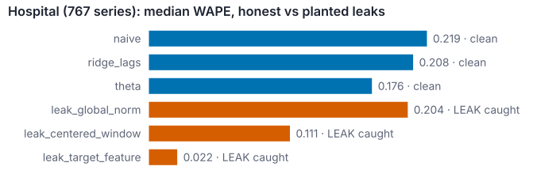

# evalkit — reproducible forecasting evaluation with leakage detection

[](https://github.com/midat-fx/rolling-backtest-evalkit/actions/workflows/ci.yml)
[](pyproject.toml)
[](pyproject.toml)
[](#develop)
[](LICENSE)

Rolling-origin backtests for demand forecasting that **cannot quietly lie**:
every model is audited for future leakage, every comparison comes with a
significance test, and CI fails when metrics drift or a leak appears. Runs on
public data (Monash, SHA-256 pinned) with numpy + pandas only.

**Leaks make a model look better. evalkit catches them.** Three realistic bugs
planted next to honest models on 767 real hospital series: each one improves
WAPE, each one is flagged, and the gate fails.



**Better on average is not the same as better.** Average ranks across 767
series with the Nemenyi critical difference: theta and SES are not separable by
rank, even though the DM test on mean MASE says theta is more accurate
(Holm p = 3.4e-06). The report shows both.



**Results on real data** (5 rolling origins, 12-month horizon, MASE scaled by
the seasonal-naive error; full tables in [docs/results.md](docs/results.md)):

| dataset | series | best model | mean MASE [95% CI] | runner-up (mean MASE) | DM best vs runner-up (Holm p) |
|---|---|---|---|---|---|
| hospital | 767 | theta | 0.7969 [0.7766, 0.8173] | holt_winters (0.8144) | 0.00013 |
| tourism_monthly | 366 | holt_winters | 1.3271 [1.2679, 1.3869] | seasonal_drift (1.4212) | 2.6e-06 |

Different data, different winner: a fixed favourite model would get one of
these wrong.

```console
$ evalkit fetch hospital
evalkit fetch: wrote data/hospital.csv (64428 rows, 767 series, sha256 8fd4085efb45 ok)
$ evalkit run --config configs/hospital.yaml --data data/hospital.csv -o out/hospital -j 8
evalkit run: run_id=ea816b669b2a leakage_ok=True
evalkit run: wrote out/hospital/metrics.csv, report.md, report.html, stats.json, manifest.json
$ evalkit gate out/hospital/metrics.csv --baseline reports/baseline_hospital.csv
OK: metrics match baseline within tolerance
```

## Quickstart

```bash
pip install -e ".[dev]"
evalkit data    -o data/demand.csv                                   # seeded synthetic panel
evalkit quality data/demand.csv                                      # dup/negative/gap checks
evalkit run     --config configs/synthetic.yaml --data data/demand.csv -o reports
evalkit report  reports/metrics.csv                                  # median metrics by model
evalkit gate    reports/metrics.csv --baseline reports/baseline_metrics.csv
open reports/report.html                                             # the full report

make fetch && make gate-real          # real data: download (checksum-verified) and gate
python examples/leakage_demo.py       # honest vs leaky models, shuffled vs rolling CV
```

## What it does

- **Rolling-origin backtest** — expanding window, configurable `min_train`,
  `horizon`, `step`; unequal-length panels aligned on each series' end.
  `-j N` runs series in parallel with byte-identical output.
- **11 models behind a registry** — `naive`, `seasonal_naive`, `drift`,
  `moving_average`, `seasonal_drift`, a numpy ridge on lags ≥ horizon, `ses`,
  `holt`, `holt_damped`, `holt_winters` (vectorised grid-search ETS) and
  `theta`. Configs pick models by name.
- **Metrics** — WAPE, sMAPE, MASE, RMSSE, bias with explicit (seasonal-)naive
  scales. See [docs/methodology.md](docs/methodology.md).
- **Significance** — bootstrap CIs over series, pairwise Diebold-Mariano with
  the Harvey-Leybourne-Newbold correction and Holm adjustment, Friedman test and
  Nemenyi critical difference. Distributions implemented in numpy and checked
  against published tables.
- **Leakage detection** — five detectors: feature future-dependence, target
  correlation, split contamination, a black-box **model future-access** audit
  run on every model in every run, and temporal order of splits.
- **Gate** — `evalkit gate` fails on metric drift beyond tolerance, if no
  trained model beats naive, or if the run manifest records leakage.
- **Self-contained HTML report** — metrics with CIs and ranks, charts by fold
  and by horizon, the DM matrix, the leakage audit and the manifest. Inline SVG,
  no JavaScript, no CDN; published to GitHub Pages by a workflow.
- **Provenance** — `manifest.json` with a `run_id` derived from config + data
  checksum, the leakage verdicts and library versions.

## Leakage: the core idea

A model that reads the future changes its forecast when you change the future.
That is directly testable, without knowing how the model works:

```python
from evalkit.leakage import detect_model_future_access

finding = detect_model_future_access(model, y, promo, origin=60, horizon=12)
finding.leaked   # True if the forecast changes when y[60:] is altered
```

`python examples/leakage_demo.py --data data/hospital.csv --config configs/hospital.yaml`:

| model | median WAPE | median MASE | model_future_access |
|---|---|---|---|
| naive | 0.2188 | 1.0056 | clean |
| ridge_lags | 0.2080 | 0.8966 | clean |
| theta | 0.1755 | 0.7978 | clean |
| leak_global_norm | 0.2037 | 0.8690 | **LEAK** |
| leak_centered_window | 0.1110 | 0.5026 | **LEAK** |
| leak_target_feature | 0.0223 | 0.0933 | **LEAK** |

Same ridge, evaluated with shuffled 5-fold instead of rolling origins: WAPE
0.2215 → 0.1861, and `temporal_order` flags the split. The global-normalisation
leak is the instructive one: a small gain, believable, and on the synthetic
panel enough to beat the best honest model. Details in
[docs/leakage.md](docs/leakage.md).

## Use it as a CI gate

The repo dogfoods its gate (`.github/workflows/ci.yml`), including a step that
asserts a run with planted leaks **fails**:

```yaml
- run: |
    evalkit run --config configs/synthetic.yaml --data data/demand.csv -o out
    evalkit gate out/metrics.csv --baseline reports/baseline_metrics.csv
- run: |
    evalkit run --config configs/leakage_demo.yaml --data data/demand.csv -o out/leak
    ! evalkit gate out/leak/metrics.csv --baseline out/leak/metrics.csv
```

## Develop

```bash
make check     # ruff + mypy --strict + pytest
make all       # check + coverage + baseline gate + leakage demo + mutation check
```

Quality bar: `ruff` and `mypy --strict` clean; 84 tests including
property-based tests (hypothesis) and determinism tests; 99% line coverage of
`src/` (CI floor 95%); a mutation check that plants 17 bugs in the metric and
statistics code and requires a failing test for each (17/17 killed); CI on
Python 3.11–3.13.

## Docs

- [docs/results.md](docs/results.md) — full results on hospital and tourism.
- [docs/methodology.md](docs/methodology.md) — backtest, models, metrics, significance, the gate.
- [docs/leakage.md](docs/leakage.md) — the five detectors and the planted-leak demo.
- [docs/determinism.md](docs/determinism.md) — what is reproducible and how it is enforced.
- [docs/performance.md](docs/performance.md) — vectorised ETS, parallel series, benchmarks.
- [docs/data.md](docs/data.md) — sources, licences, checksums.
- [docs/notes.md](docs/notes.md) — known gaps and what was left out.

## License

MIT © Midat Faizov. A public, clean-room implementation of leakage-aware,
reproducible forecast evaluation; no proprietary code or data. Monash datasets
are CC BY 4.0, see [docs/data.md](docs/data.md).
